<p align="center">
  <picture>
    <source media="(prefers-color-scheme: dark)" srcset="docs/readme/icon-dark.png">
    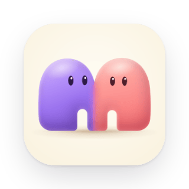
  </picture>
</p>

<h1 align="center">Murmur</h1>

<p align="center">
  <b>A beautiful way to use Hermes.</b><br>
  Chat with your own AI agents, one at a time or all together.<br>
  In the browser, on your Mac or PC, and on your phone.
</p>

<p align="center">
  <a href="#get-murmur"><b>Get Murmur</b></a> ·
  <a href="#bring-your-hermes-or-start-fresh">Your Hermes</a> ·
  <a href="#what-you-can-do">Features</a> ·
  <a href="#how-it-works">How it works</a> ·
  <a href="docs/DEVELOPMENT.md">Develop</a>
</p>

<p align="center">
  <picture>
    <source media="(prefers-color-scheme: dark)" srcset="docs/readme/hero-dark.png">
    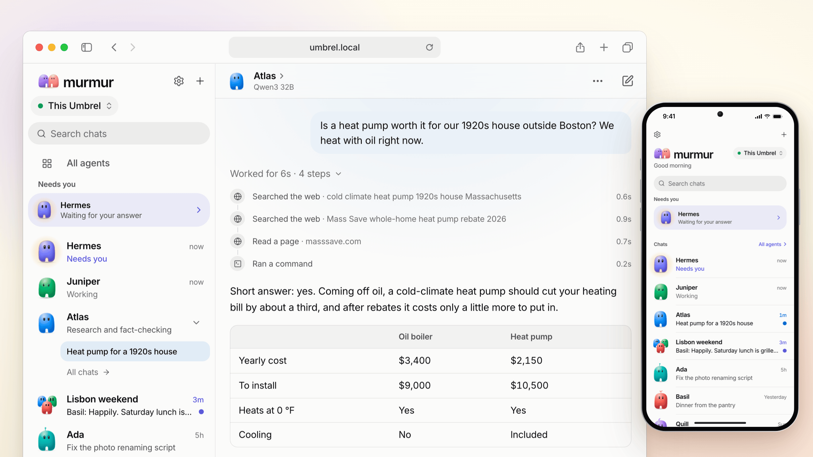
  </picture>
</p>

Murmur is the app for [Hermes Agent](https://github.com/NousResearch/hermes-agent), the open-source agent that runs on your own hardware, remembers what matters, uses tools and gets things done. Murmur is the friendly face on top. There are no terminals, config files or jargon. Make a few agents, give each one a personality, and talk to them from anywhere.

<p align="center">
  <picture>
    <source media="(prefers-color-scheme: dark)" srcset="docs/readme/preview-dark.webp">
    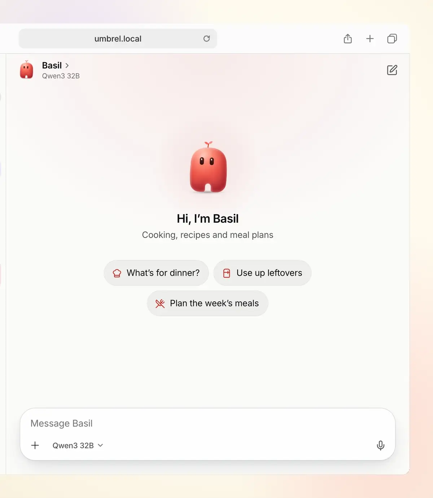
  </picture>
</p>

## One Murmur, everywhere

<picture>
  <source media="(prefers-color-scheme: dark)" srcset="docs/readme/everywhere-dark.png">
  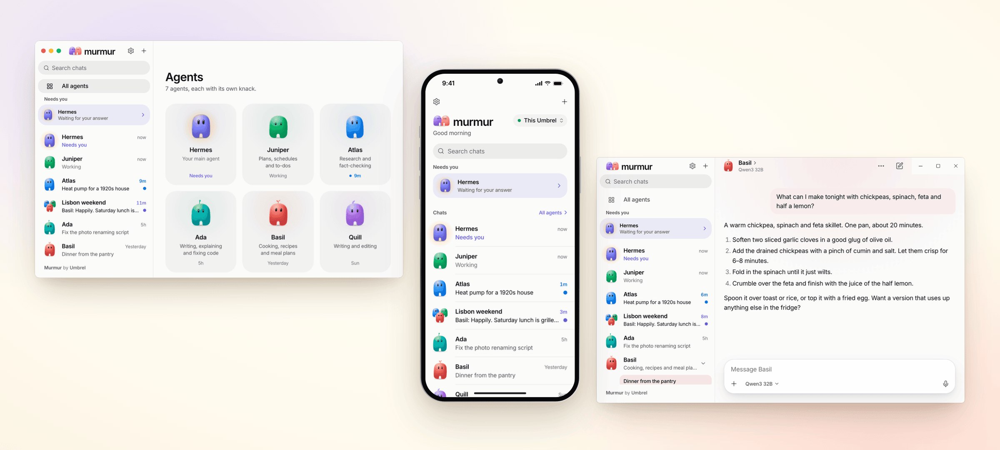
</picture>

Open it in any browser on your network, install the app for **macOS**, **Windows** or **Linux**, or add it to your phone's home screen. It's the same Murmur everywhere, with the same agents and chats, and every chat picks up where you left off on another device.

## Bring your Hermes, or start fresh

### Make an agent in seconds

<picture>
  <source media="(prefers-color-scheme: dark)" srcset="docs/readme/agents-edit-dark.png">
  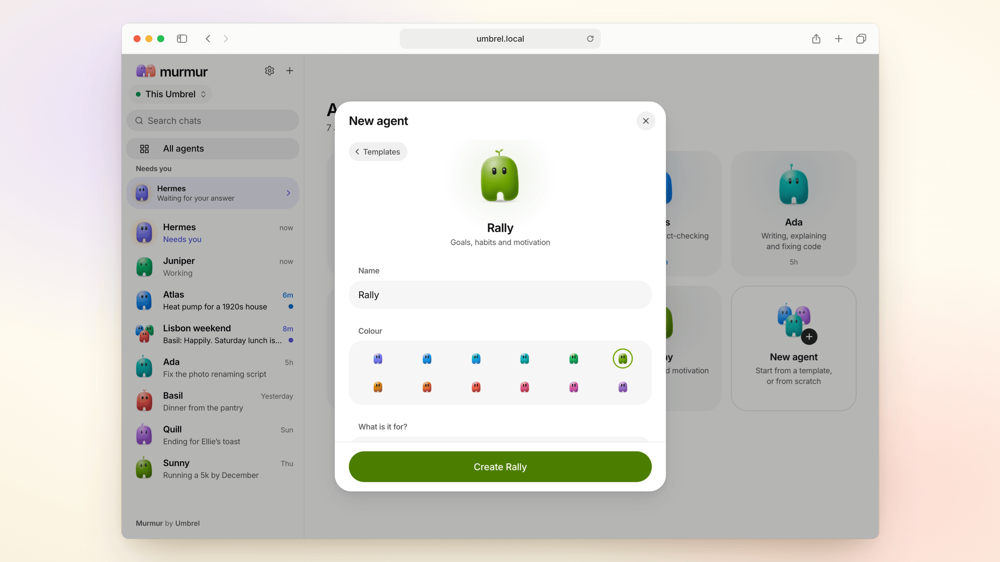
</picture>

Start from a template (Researcher, Writer, Planner, Coder, Coach or Chef) or from scratch. Pick a name and a colour, say what it's for, and it's ready to talk.

### Or connect the Hermes you already have

<picture>
  <source media="(prefers-color-scheme: dark)" srcset="docs/readme/connect-dark.png">
  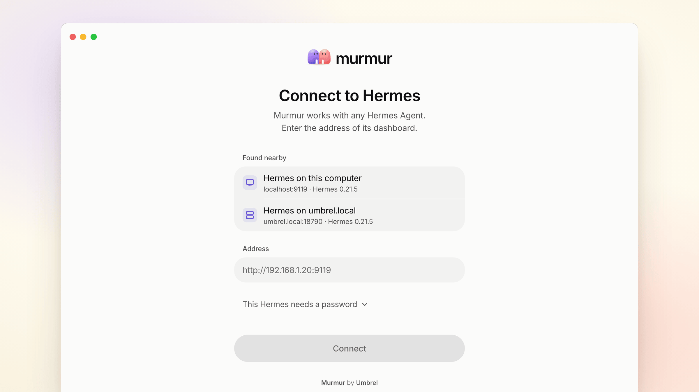
</picture>

Murmur comes with Hermes built in, so you can start fresh with nothing else to install. Already have Hermes? It can live anywhere: on your Umbrel, a Mac in the closet, a Linux box, a Raspberry Pi or a server in the cloud. Murmur finds the ones on your network for you, or you can paste an address. On umbrelOS it spots the Hermes Agent app by itself and offers it, with your agents already there.

### No model yet? Connect one in a minute

<picture>
  <source media="(prefers-color-scheme: dark)" srcset="docs/readme/onboarding-wide-dark.png">
  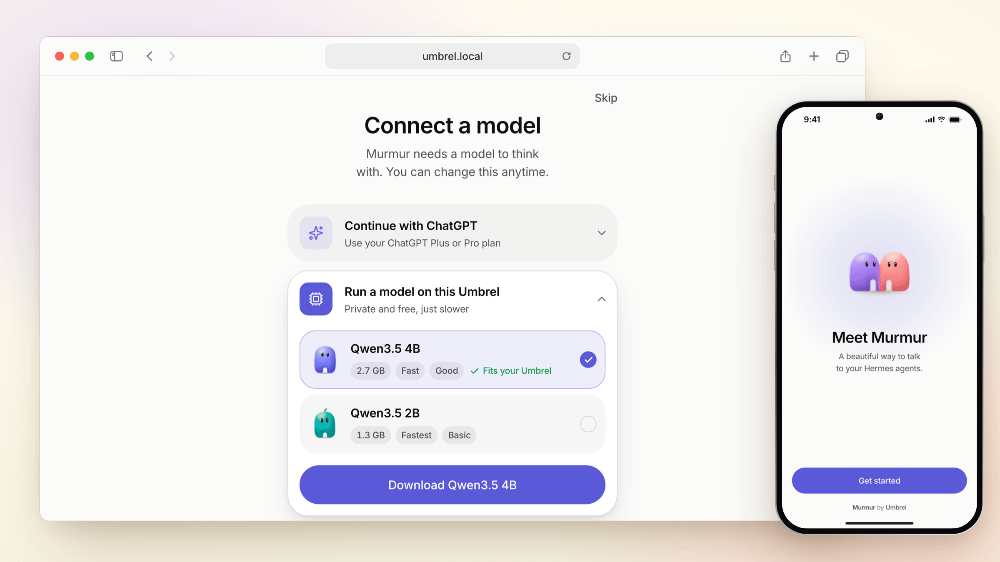
</picture>

Sign in with your ChatGPT plan, or run a model right on your Umbrel: Murmur picks one that fits its memory and sets it up in one tap, using its graphics when it has them. Or use Ollama or another model server, or an API key from OpenRouter, OpenAI, Anthropic and others. You can switch any time.

### Every chat comes with you

<picture>
  <source media="(prefers-color-scheme: dark)" srcset="docs/readme/history-dark.png">
  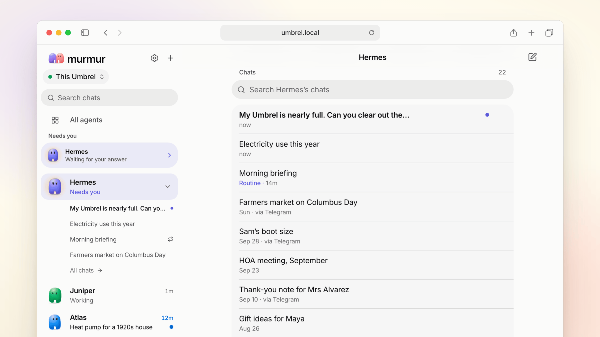
</picture>

Your agents, their memories and every past chat show up the moment you connect. That includes chats from the Hermes dashboard, Hermes Desktop, the terminal and Telegram. Nothing to import, nothing copied: it all stays in your Hermes.

### More than one Hermes? No problem

<picture>
  <source media="(prefers-color-scheme: dark)" srcset="docs/readme/servers-dark.png">
  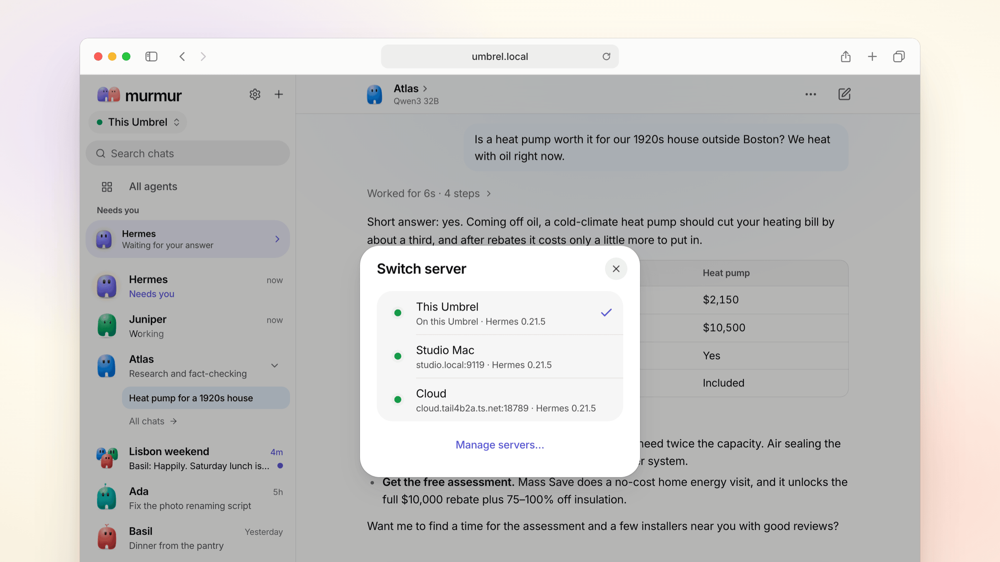
</picture>

Keep a Hermes at home and another at work, and switch between them in one tap.

## What you can do

<picture>
  <source media="(prefers-color-scheme: dark)" srcset="docs/readme/buddies-dark.png">
  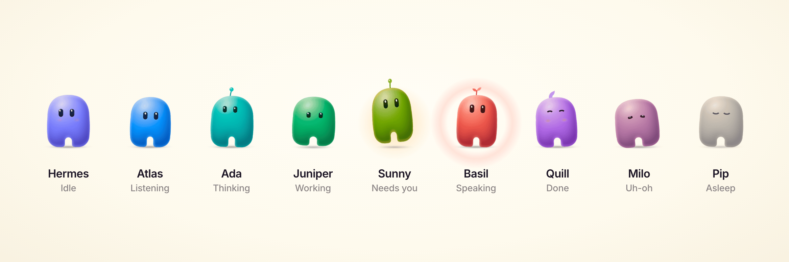
</picture>

### Agents with a personality
Every agent is a **Buddy**, a little character in its own colour that shows what it's doing at a glance: listening, thinking, working, waiting on you, or done. Anything that needs you rises to the top.

### Chats that show their work

<picture>
  <source media="(prefers-color-scheme: dark)" srcset="docs/readme/work-dark.png">
  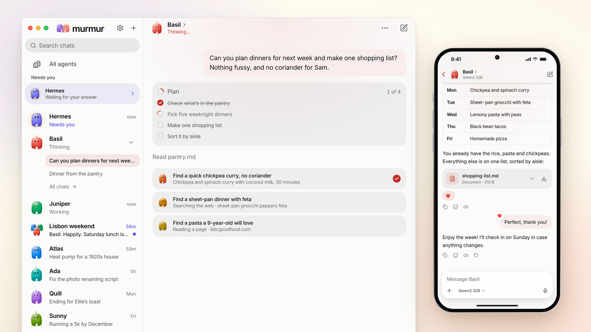
</picture>

Answers stream in as they're written. When an agent searches the web, reads a file or runs a command, you see it in plain words, and you can open any step. Stop it, steer it mid-answer, edit your last message, or have the answer read aloud.

### You stay in charge

<picture>
  <source media="(prefers-color-scheme: dark)" srcset="docs/readme/approval-wide-dark.png">
  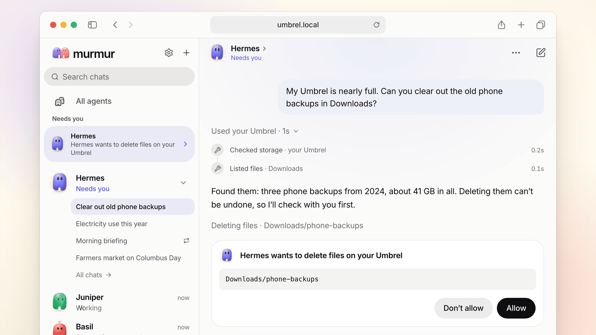
</picture>

On umbrelOS, your agents can work with your Umbrel itself, through the tools it offers them. Before anything changes, like deleting files, the agent asks in plain words and waits for *Allow* or *Don't allow*. Whatever is waiting on you rises to the top.

### Group chats

<picture>
  <source media="(prefers-color-scheme: dark)" srcset="docs/readme/group-wide-dark.png">
  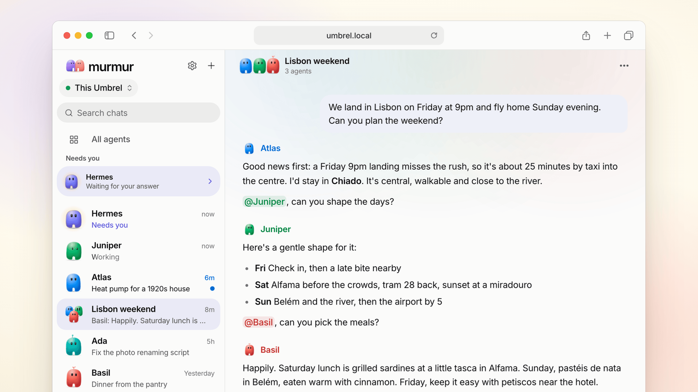
</picture>

Put a few agents in one room and let them work it out together. Mention one with **@** to ask just them. Each one speaks in its own colour.

### In your pocket, too

<picture>
  <source media="(prefers-color-scheme: dark)" srcset="docs/readme/phones-dark.png">
  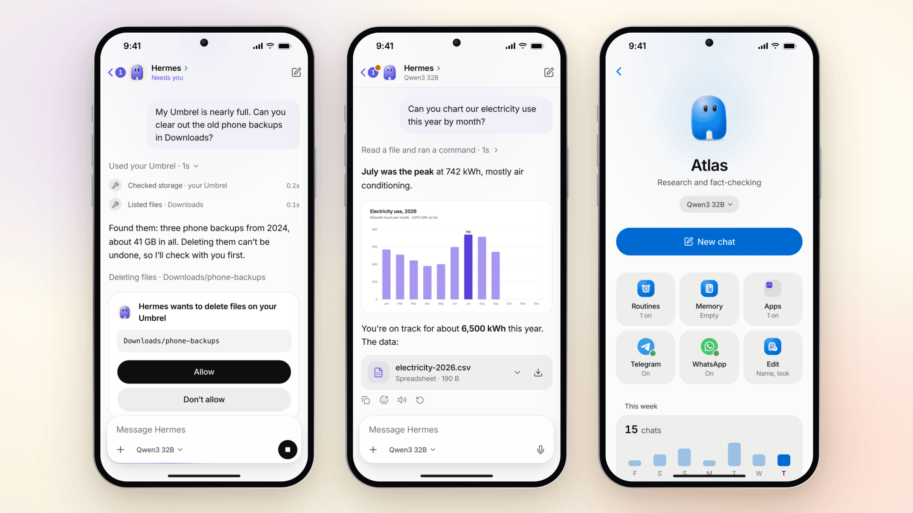
</picture>

- **Answer from anywhere.** Approvals, questions and replies follow you to your phone.
- **Pictures, files and live widgets.** Send photos and files, and get images, downloads and little interactive tools back right in the chat.
- **Routines, memory and Telegram.** Ask for a briefing every morning at 8. See what an agent remembers, and change or forget any of it. Text your agent on Telegram after scanning a QR code.

### And the details
- **Choose the model and how hard it thinks** for each agent or chat.
- **Give it a goal** with `/goal`, and the agent keeps working until it's done. Ask a quick side question with `/btw` without interrupting it.
- **Search every chat**, with a command palette and keyboard shortcuts on desktop.
- **Light and dark**, desktop notifications and a Dock badge, and fluid at every screen size.

## Get Murmur

<table>
<tr>
<td width="50%" valign="top">

#### On umbrelOS
Install **Murmur** from the Umbrel App Store. It comes with Hermes built in. Already use the **Hermes Agent** app? Murmur finds it and offers to use it instead, agents and all.

</td>
<td width="50%" valign="top">

#### On your Mac or PC
Download Murmur for macOS, Windows or Linux from [Releases](https://github.com/getumbrel/murmur/releases), open it, and pick your Hermes from the list.

</td>
</tr>
</table>

#### With Docker
Run Murmur with its own Hermes:

```sh
curl -fsSLO https://raw.githubusercontent.com/getumbrel/murmur/master/docker-compose.yml
curl -fsSL https://raw.githubusercontent.com/getumbrel/murmur/master/.env.example -o .env
# set MURMUR_HERMES_PASSWORD in .env, then:
docker compose up -d
```

Or run Murmur alone and point it at your Hermes. [`docs/STANDALONE.md`](docs/STANDALONE.md) has every option.

```sh
docker run -d -p 3000:3000 -v murmur:/data ghcr.io/getumbrel/murmur:0.4
```

Murmur comes with **Hermes 0.22.0**, and works with any **Hermes Agent 0.21.4 or newer**. If yours is older, Murmur shows you how to update it.

## How it works

<picture>
  <source media="(prefers-color-scheme: dark)" srcset="docs/readme/how-it-works-dark.png">
  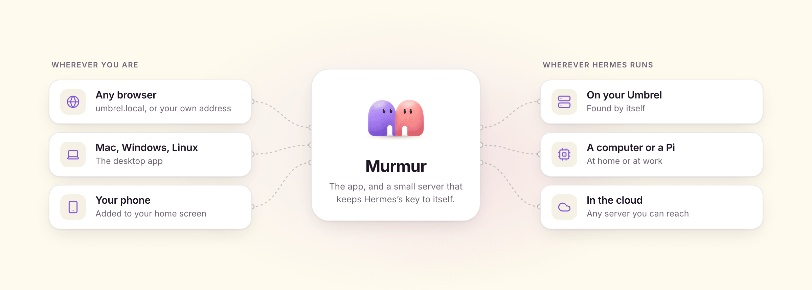
</picture>

- **Hermes does the work.** Agents are Hermes profiles and chats are Hermes sessions. Murmur reads and writes the same data, so it stays in sync with the Hermes dashboard, Hermes Desktop and Telegram.
- **Hermes comes along.** On umbrelOS and with Docker Compose, Murmur runs its own Hermes right beside it, private to Murmur. Or it uses a Hermes you already have.
- **Murmur is the experience.** A mobile-first React app and a tiny Node server with no dependencies. The browser never sees Hermes's access key.
- **The desktop app** is the same Murmur in a native window, with its server built in.

## Privacy and security

- Everything runs on hardware you control. Murmur talks only to your Hermes.
- On umbrelOS, Murmur sits behind your Umbrel login. On its own, you can give it a password (`MURMUR_PASSWORD`).
- Hermes's access key stays on Murmur's server, and Murmur refuses requests from other websites.

## Develop

```sh
npm install
docker compose -f dev/docker-compose.yml up -d        # a local Hermes, like the Umbrel app
HERMES_URL=http://localhost:18789 npm run dev:server   # Murmur's server on :3000
npm run dev:web                                        # the app on :5173, with hot reload
```

[`docs/DEVELOPMENT.md`](docs/DEVELOPMENT.md) covers the architecture, server settings, tests, releases and updating the Hermes client. [`docs/DESKTOP.md`](docs/DESKTOP.md) covers the desktop app, and [`docs/DESIGN.md`](docs/DESIGN.md) and [`docs/BRAND.md`](docs/BRAND.md) cover design and brand.

## License

[MIT](LICENSE). Murmur includes Hermes Agent's typed client, which is also MIT.

<p align="center">
  <br>
  <br>
  <sub><b>Murmur</b> by <a href="https://umbrel.com">Umbrel</a></sub>
</p>
